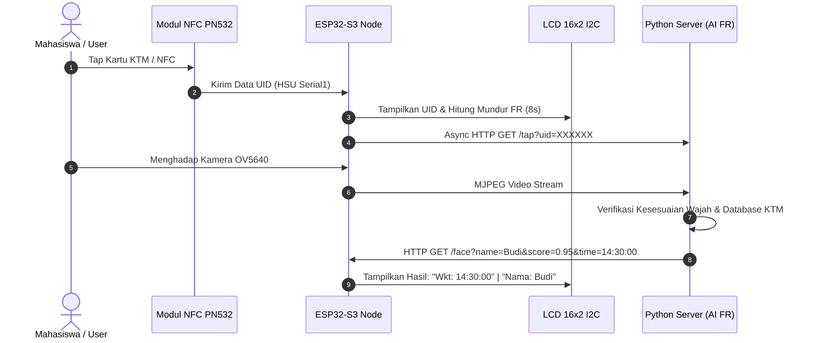
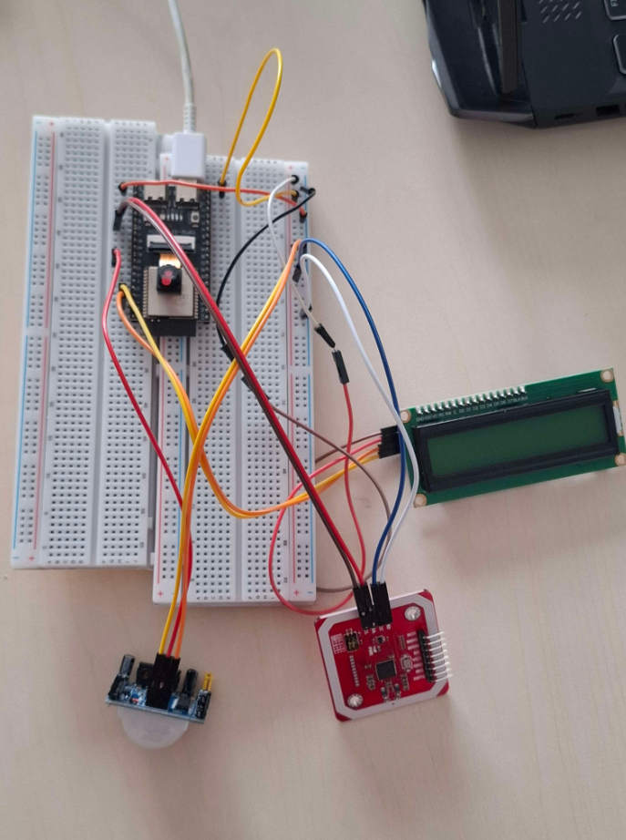
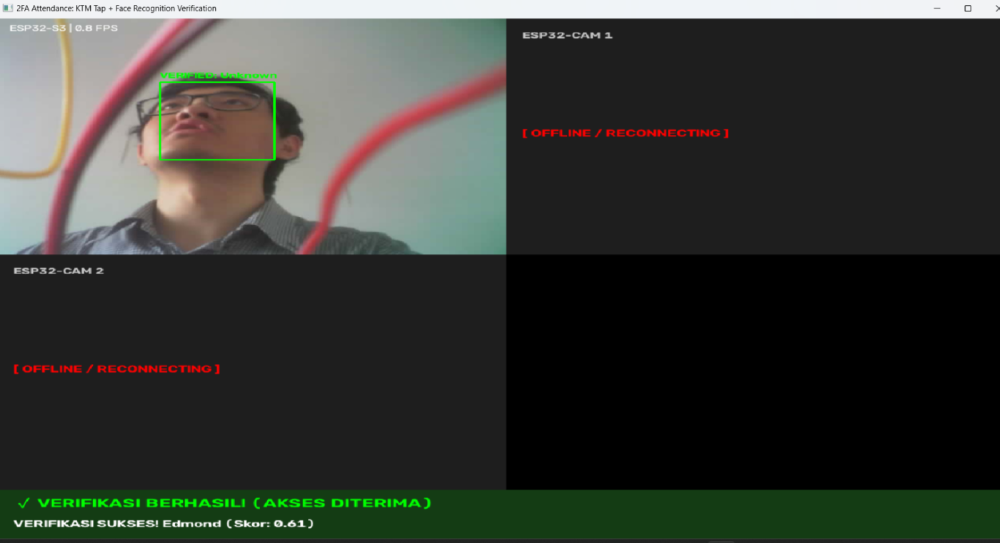

<div align="center">

# ESP32-S3 Dual-Factor Attendance Node
### Smart NFC Card Reader (PN532 HSU), OV5640 Camera Streamer & AI Face Recognition Verification

[](https://www.espressif.com/)
[](https://www.arduino.cc/)
[](https://www.adafruit.com/product/364)
[](https://www.freertos.org/)
[](LICENSE)

<p align="center">
  <b>Simpul IoT Presensi / Akses Cerdas 2-Faktor berbasis ESP32-S3 dengan Pembaca Kartu KTM (NFC PN532 HSU), Kamera OV5640 5MP, Layar LCD I2C, dan Sensor Gerak PIR.</b>
</p>

</div>

---

## Gambaran Umum (Overview)

**ESP32-S3 Dual-Factor Attendance Node** adalah perangkat *edge IoT* untuk sistem presensi dan verifikasi identitas dua faktor (*2-Factor Authentication*). Perangkat ini memadukan **Kartu Tanda Mahasiswa (KTM / Kartu RFID NFC)** dan **Pengenalan Wajah Berbasis AI (*Face Recognition*)**.

Alur kerja sistem:
1. Pengguna menempelkan kartu KTM/NFC ke modul **PN532**.
2. ESP32-S3 secara instan mengekstrak UID kartu dan mengirimkan notifikasi *asinkron* (FreeRTOS Task) ke server AI Python (`ktm_face_verification.py`).
3. Layar LCD 16x2 membuka **jendela waktu 8 detik (*8-second countdown*)** untuk memindai wajah pengguna di depan kamera **OV5640**.
4. Server Python memverifikasi kecocokan wajah dengan pemilik kartu, lalu mengirimkan hasil validasi balik ke ESP32-S3 via endpoint `/face` untuk ditampilkan di LCD.

---

## Fitur Utama (Key Features)

- **High Sensitivity NFC/RFID Reader (PN532 via HSU Serial1)**:
  - Menggunakan komunikasi *High-Speed UART* (GPIO 47/48) yang bebas interferensi dari jalur kamera dan I2C.
  - Dioptimasi dengan *Max RF Receiver Gain* (43dB) sehingga sangat responsif membaca kartu ISO 14443-A (KTM, E-Money, Flazz, e-KTP, NFC Smartphone).
- **Asynchronous FreeRTOS Webhook**:
  - Pengiriman event tap kartu ke server backend berjalan di background thread terpisah tanpa memblokir streaming kamera atau refresh LCD.
- **High Definition Video Streaming (OV5640 5MP)**:
  - Streaming video MJPEG lancar berkat akselerasi Octal/OPI PSRAM ESP32-S3.
- **Interactive 16x2 I2C LCD Interface**:
  - Menampilkan jam digital real-time (NTP Sync GMT+7).
  - Tampilan UID kartu dan hitung mundur (*countdown*) verifikasi wajah 8 detik tanpa flicker.
  - Menampilkan nama dan waktu presensi yang terverifikasi.
- **PIR Motion-Activated Power Management**:
  - Otomatis aktif saat mendeteksi gerakan manusia atau tap kartu, dan masuk mode hemat daya (*sleep/standby*) setelah 5 menit tanpa aktivitas.
- **Hardware Brownout & Reset Diagnostics**:
  - Diagnostik otomatis saat boot untuk memastikan kestabilan tegangan 5V/3.3V dan pemantauan sinyal RSSI WiFi.

---

## Alur Sistem & Arsitektur (System Architecture)



---

## Kebutuhan Perangkat Keras (Bill of Materials)

| Komponen | Spesifikasi / Tipe | Jumlah |
|---|---|---|
| **Mikrokontroler** | ESP32-S3 Dev Module / ESP32-S3-EYE (PSRAM OPI Enabled) | 1 unit |
| **Kamera** | OV5640 Camera Module (5 Megapixel DVP) | 1 unit |
| **Modul NFC/RFID** | PN532 NFC RFID Module (Set ke Mode HSU [0 0]) | 1 unit |
| **Layar Tampilan** | LCD 16x2 + I2C Backpack (PCF8574, Addr `0x27`) | 1 unit |
| **Sensor Gerak** | Sensor PIR HC-SR501 | 1 unit |
| ***Power Source*** | Adaptor DC 5V 2A / Step-Down Regulator Stabil | 1 unit |
| **Kabel Jumper** | Jumper Wires Female-Female & Male-Female | Secukupnya |

---

## Skematik & Wiring Pinout

| Komponen | Pin Modul | Pin ESP32-S3 | Keterangan |
|---|---|---|---|
| **NFC PN532 (HSU)** | `TX` (SDA) | **GPIO 47** | RX1 ESP32-S3 (Serial1) |
| | `RX` (SCL) | **GPIO 48** | TX1 ESP32-S3 (Serial1) |
| | `RST` | **GPIO 21** | Reset pin PN532 |
| | `VCC` & `GND` | **5V / 3.3V & GND** | Daya & Ground |
| | *DIP Switch* | **[0 0] (I0=0, I1=0)** | Mode High-Speed UART |
| **LCD 16x2 I2C** | `SDA` | **GPIO 1** | Jalur I2C Data |
| | `SCL` | **GPIO 2** | Jalur I2C Clock |
| | `VCC` & `GND` | **5V & GND** | Daya & Ground |
| **Sensor PIR** | `OUT` | **GPIO 38** | Input digital trigger |
| | `VCC` & `GND` | **5V & GND** | Daya & Ground |
| **Kamera OV5640** | *D0-D7, XCLK, PCLK, VSYNC, HREF, SCCB* | Sesuai `camera_pins.h` (`CAMERA_MODEL_ESP32S3_EYE`) | Konektor Pita DVP |

---

## 📷 Dokumentasi Foto & Hasil Kerja

<div align="center">
  <table>
    <tr>
      <td align="center" width="50%">
        
        <br/><b>Foto 1: Rangkaian Perangkat Keras (ESP32-S3 + PN532 + LCD + PIR)</b>
      </td>
      <td align="center" width="50%">
        
        <br/><b>Foto 2: Hasil Verifikasi Presensi & Pengenalan Wajah (Python Script)</b>
      </td>
    </tr>
  </table>
</div>


---

## Konfigurasi Arduino IDE

1. **Board**: `ESP32S3 Dev Module`
2. **PSRAM**: `OPI PSRAM` / `Enabled`
3. **Flash Size**: `8MB` atau `16MB`
4. **Flash Mode**: `QIO 80MHz`
5. **Partition Scheme**: `Huge APP (3MB No OTA/1MB SPIFFS)` atau gunakan `partitions.csv`
6. **USB CDC On Boot**: `Enabled`

### Library Dependencies
- **Adafruit_PN532** oleh Adafruit (Install via Arduino Library Manager)
- **LiquidCrystal_I2C** oleh Frank de Brabander
- **ESP32 Core** by Espressif (`esp_camera.h`, `WiFi.h`, `HTTPClient.h`, `Wire.h`)

---

## Panduan Instalasi & Penggunaan

### 1. Salin Template Kredensial
Salin file `secrets.example.h` menjadi `secrets.h`:
```bash
cp secrets.example.h secrets.h
```
Buka `secrets.h` dan sesuaikan:
```cpp
const char *ssid = "NAMA_WIFI_ANDA";
const char *password = "PASSWORD_WIFI_ANDA";

// IP Komputer yang menjalankan backend Python
const char* pythonServerIp = "192.168.1.50";
const int   pythonServerPort = 5050;
```

### 2. Upload ke ESP32-S3
Buka `ktm_fr_s3.ino` di Arduino IDE, pastikan pengaturan board sudah sesuai, lalu klik **Upload**.

### 3. Integrasi Backend Python
Jalankan server backend pengenalan wajah pada komputer/server lokal:
```bash
python ktm_face_verification.py
```

---

## Dokumentasi Integrasi Webhook & REST API

### 1. Webhook Tap Kartu (ESP32-S3 --> Python Backend)
Setiap kali kartu di-tap, ESP32-S3 mengirimkan:
```http
GET /tap?uid=A1B2C3D4&cam=ESP32-S3 HTTP/1.1
Host: <pythonServerIp>:5050
```

### 2. Endpoint Hasil Wajah (Python Backend --> ESP32-S3)
Setelah wajah terverifikasi cocok, server mengirimkan hasil ke ESP32-S3:
```http
GET /face?name=Budi%20Santoso&score=0.95&time=14:30:00&cam=ESP32-S3 HTTP/1.1
Host: <ESP32_IP>:80
```

---

## Struktur Repositori

```text
ktm_fr_s3/
├── .gitignore              # Mengabaikan secrets.h dan build artifacts
├── README.md               # Dokumentasi portofolio utama
├── LICENSE                 # Lisensi open-source MIT
├── secrets.example.h       # Template konfigurasi WiFi & IP Server
├── board_config.h          # Konfigurasi model board kamera ESP32-S3
├── camera_pins.h           # Definisi GPIO kamera DVP
├── camera_index.h          # Web UI stream terkompresi
├── app_httpd.cpp           # HTTP server & /face REST endpoint
├── ktm_fr_s3.ino           # Program utama (PN532 HSU, PIR, LCD, State Machine)
├── partitions.csv          # Konfigurasi partisi flash 3MB App space
├── ci.yml                  # Skrip CI
└── docs/                   # Aset dokumentasi
    ├── images/             # Foto hardware & demo
    │   └── README.md
    └── schematics/         # Diagram skematik & file Wokwi
        ├── README.md
        └── diagram.json
```

---

## Lisensi (License)

Proyek ini didistribusikan di bawah lisensi **MIT License** - lihat file [LICENSE](LICENSE) untuk detail lengkap.
